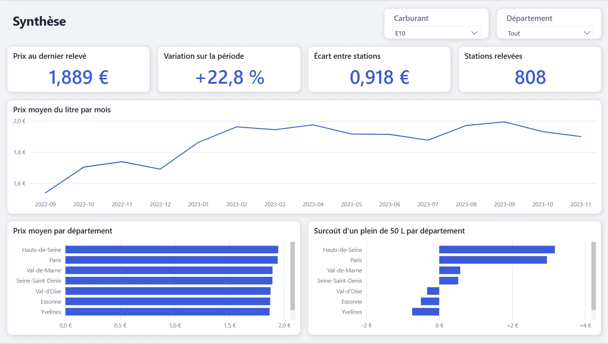
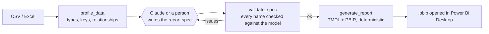
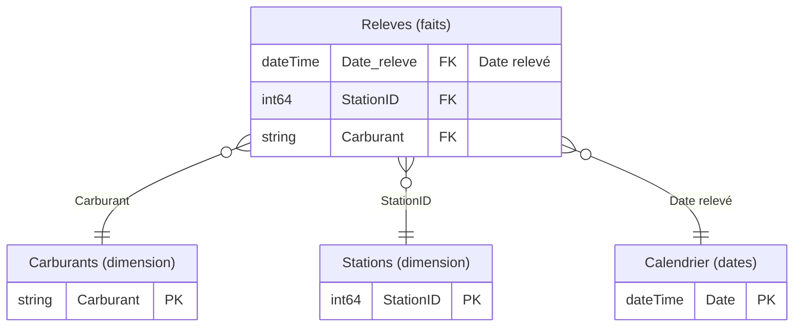
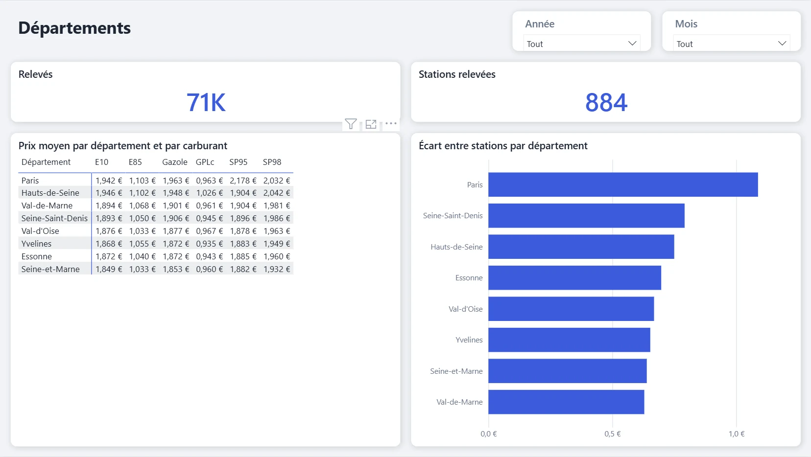
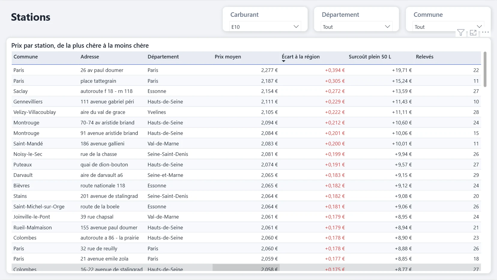
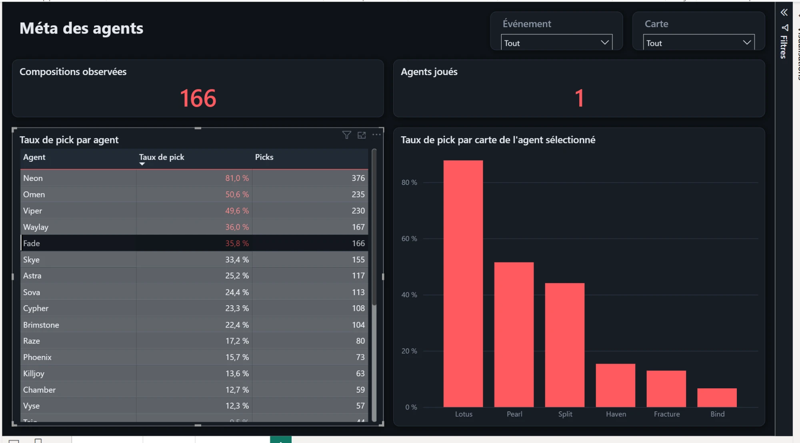

# pbip-generator

[](https://github.com/MatALass/pbip-generator/actions/workflows/ci.yml)


Generate a complete, ready-to-open **Power BI project** (star schema, DAX measures, report pages)
from a folder of CSV or Excel files, in under a second.

## Result on public data

The [fuel price example](#public-data-example-fuel-prices-in-ile-de-france) starts from the official
French fuel price feed: 70,771 prices of 884 stations in Ile-de-France, from September 2022 to
November 2023.

| | |
|---|---|
| Input | 3 CSV files (prices, stations, fuels) and a 124-line report spec |
| Output | 44 files: 4 tables, 3 relationships, 11 DAX measures, 3 pages, 22 visuals, a data dictionary |
| Generation time | 0.4 s on a laptop, every file checked against Microsoft's schemas and loaded with TOM in CI |
| Same project by hand | about 3 hours by my estimate (breakdown below), not timed |



What the generated report shows, once refreshed in Power BI Desktop:

- **A full tank of E10 costs 4.80 € more in Hauts-de-Seine than in Seine-et-Marne.** For E10, a 50 L tank is 3.17 €
  above the regional average in Hauts-de-Seine and 1.65 € below it in Seine-et-Marne.
- **E10 went up 22.8 % in 14 months** (1.538 € to 1.889 € per litre, 15/09/2022 to 15/11/2023),
  diesel only 6.6 %. The September 2022 prices still include the state rebate at the pump, which ended
  on 31/12/2022.
- **Stations of the same region differ by 0.92 € per litre** for E10 (average over the period), so the
  choice of station matters more than the choice of department.

## How it works: Claude decides, the code writes



A language model is good at choosing what a report should show for a given audience, and bad at writing
hundreds of JSON files by hand. So the split is strict: the model only fills a typed spec (pages,
measures, visuals, by name), the code checks every name against the data and writes every file. Same
spec, same files. The four steps are exposed as tools of an [MCP server](#mcp-server-let-claude-write-the-spec),
so Claude Desktop or Claude Code can build a report from a conversation.

## Why

- **The problem**: small and mid-sized companies report from Excel, and turning those files into a clean
  Power BI model (star schema, typed queries, calendar, measures) is hours of repetitive clicking.
- **For whom**: data analysts and consultants who deliver Power BI reports, and anyone who wants
  reports reviewed as code (PBIP is plain text, the output is deterministic).
- **What exists**: Copilot in Power BI builds visuals inside a model you already have; Tabular Editor and
  `pbi-tools` edit or deploy existing models. pbip-generator creates the model *and* the report from raw
  files, and lets a language model decide the report's content through a typed, validated spec while
  deterministic code writes every file.

It writes a [Power BI Project (PBIP)](https://learn.microsoft.com/power-bi/developer/projects/projects-overview):
a semantic model in **TMDL** and a report in **PBIR**, both plain text. You open the `.pbip` in
Power BI Desktop, click *Refresh*, and get a working star schema with measures and report pages.

```
data/                         output/Carburants/
├── releves.csv     ──►       ├── Carburants.pbip
├── stations.csv              ├── Carburants.SemanticModel/definition/   (TMDL)
└── carburants.csv            ├── Carburants.Report/definition/          (PBIR)
                              └── DATA_DICTIONARY.md
```

## Public data example: fuel prices in Ile-de-France

**Business question**: where and when is a full tank the most expensive in Ile-de-France, and by how much?

```bash
pip install -e .
pbip-generator build examples/carburants/data --spec examples/carburants/report.yaml -o output --strict
# then open output/Carburants/Carburants.pbip in Power BI Desktop and click Refresh
```

### Data

[`fetch_data.py`](examples/carburants/fetch_data.py) rebuilds the three CSV files from
[etalab/prix-carburants-data](https://github.com/etalab/prix-carburants-data), Etalab's daily copy of the
government feed *Prix des carburants en France* (data.gouv.fr, Licence Ouverte; the copy is MIT). It
pins the source commit, so the files are the same on every machine, and works with the standard
library only:

```bash
python examples/carburants/fetch_data.py               # Ile-de-France, the files committed here
python examples/carburants/fetch_data.py --region 84 -o data/ara   # any other region
```

| | |
|---|---|
| Period | 15/09/2022 to 15/11/2023, 2 snapshots per month (29 dates) |
| Scope | 884 stations of the 8 departments of Ile-de-France, 6 fuels |
| Rows | 70,771 prices kept out of 79,031 read |
| Rejected | 8,260 prices (10.5 %) not updated in the 7 days before the snapshot: a station that stops updating would repeat an old price for months |

### Model

Generated in `DATA_DICTIONARY.md` with the rest of the project, so it cannot drift from the TMDL
(a test checks that this copy is up to date):



**Grain of `Releves`**: one row per `Date relevé` + `Carburant` + `StationID`. The tool computes it
from the data (smallest unique set of keys and dates) and says so when no such set exists.

### Measures

| Measure | What it computes, and the trap it avoids |
|---|---|
| `Prix moyen` | `AVERAGE` of the price per litre. A sum of prices means nothing: the tool now averages any unit price or rate by default (`Prix au litre`, `Taux`, `%`) |
| `Relevés`, `Stations relevées` | Rows and distinct stations, to see how much data is behind a figure (October 2022 has half the usual prices, most likely the refinery strikes) |
| `Prix moyen de la région` | `Prix moyen` with `REMOVEFILTERS(Stations)`: the filters on fuel and date stay, so diesel is always compared with diesel |
| `Écart à la région` | `Prix moyen` minus the regional average, in € per litre: positive means more expensive |
| `Surcoût plein 50 L` | The gap times 50 L: a figure a non-analyst reads without thinking |
| `Prix au premier relevé`, `Prix au dernier relevé` | `Prix moyen` at the first and last date of the selection (`MIN` / `MAX` of the date, then `CALCULATE`), so a KPI card shows a current price and not a 14-month average |
| `Variation sur la période` | `DIVIDE` of the two, blank instead of an error when a price is missing |
| `Écart entre stations` | `ADDCOLUMNS` over the stations, then max minus min: the spread between the cheapest and the most expensive station of the selection |

### Pages

Screenshots of the generated report in Power BI Desktop, after *Refresh*, nothing edited by hand.

**Synthèse**: how much is a litre now, how did it move in 14 months, which departments are above the
average? Screenshot at the [top of this page](#result-on-public-data), with E10 selected.

**Départements**: how do departments compare, fuel by fuel? The matrix has fuels in columns and no
total, because an average over several fuels is meaningless.



**Stations**: which stations are the cheapest and the most expensive for one fuel? Gaps above 5 cents
in red, below -5 cents in green.



The fuel slicer of *Synthèse* and *Stations* forces exactly one value (E10, the first one, when the report opens), for the same reason as the
matrix: no figure on these pages ever mixes two fuels.

### Modeling decisions

- **Stations is one flat dimension** (address, commune, department, region in the same table) and not a
  snowflake: there are 884 rows, and a reader filters by department without knowing a second table exists.
- **Fuels is a dimension of 6 rows** instead of a text column in the fact table, to carry a readable label
  and a family (diesel, petrol, gas) without repeating them on 70,771 rows.
- **The calendar is generated** (full years, month sort order, marked as date table) so that time functions
  and month axes work. The snapshot date is the only date of the fact table.
- **No calculated column.** Everything that depends on the filters (averages, gaps, spread) is a measure;
  the only derived columns are the calendar's.
- **Automatic measures are off for this report** (`auto_measures: false`): with 14 months of data, the
  default year-over-year measures would compare two months of 2022 with a full 2023.
- **`Code postal` is forced to text** in the spec, and latitude and longitude are hidden: they are not
  quantities, and nothing in the report draws a map.

### Time saved: what the generator does instead of you

The manual time is my estimate for an analyst who knows Power BI, not a measurement:

| Step | Objects | By hand |
|---|---|---|
| Import and type the files | 3 queries, 15 columns | 15 min |
| Calendar table with sort orders | 8 columns, marked as date table | 20 min |
| Relationships, hidden keys, formats | 3 relationships, 8 hidden columns, 8 formats | 15 min |
| DAX measures, with descriptions | 11 measures (one hidden color measure) | 45 min |
| Pages and visuals, aligned | 3 pages, 22 visuals (7 slicers, 6 cards) | 60 min |
| Conditional formatting, data dictionary | 1 rule, 1 Markdown file | 25 min |
| **Total** | | **about 3 h, against 0.4 s plus the time to write the spec** |

What is left to a person is the part that needs thinking: the business question, the measures and the
pages, written once in the spec (or drafted by Claude through the MCP server, then reviewed).

### Limits of this example

- `Prix moyen` is the average of the prices **shown** by the stations, not weighted by volumes sold
  (the feed has no volumes). A motorway station counts as much as a supermarket one.
- Two snapshots per month: short price spikes between two dates are not seen.
- Data stops in November 2023, when Etalab's history ends.
- A station with very few prices weighs as much as the others in its row of the *Stations* table: the
  most expensive E10 station (Saint-Ouen, +0.51 € per litre) has a single price in 14 months. The
  `Relevés` column is there to spot those rows.

## What it builds

| Layer | Generated automatically |
|---|---|
| Power Query | One query per CSV file / Excel sheet, typed columns, a `DataFolder` parameter |
| Model | Fact/dimension detection, many-to-one relationships, key columns hidden, a cycle-free graph |
| Calendar | `Calendrier` table spanning the data's full years, month/weekday sort orders, marked as date table |
| Measures | `Total <column>` per numeric column (`Moyenne <column>` for unit prices and rates), `Nb <table>`, and N-1, variation % and year-to-date for the main measure |
| Report | *Vue d'ensemble* page (slicers, KPI cards, line, column, bar and donut charts) and a *Détail* page (table) |
| Documentation | `DATA_DICTIONARY.md`: a Mermaid diagram of the model, the grain of each fact table, tables, columns, relationships and measures (with their DAX) |

Everything inferred can be corrected or extended with a YAML file (roles, types, relationships,
hidden columns, custom DAX measures). Output is deterministic: same input, same files, clean git diffs.

## Install

```bash
pip install git+https://github.com/MatALass/pbip-generator
# or, from a clone
pip install -e ".[dev]"
```

Requires Python 3.10+.

## Usage

```bash
# 1. Generate
pbip-generator build path/to/data -o output --name Ventes

# 2. Optional: dump what was inferred, edit it, regenerate
pbip-generator init-config path/to/data -o config.yaml
pbip-generator build path/to/data -c config.yaml -o output --overwrite
```

Useful options:

| Option | Purpose |
|---|---|
| `--data-folder "C:\Users\me\data\"` | Folder Power BI reads from, on the machine that opens the project. Defaults to the absolute path of the input folder. Can also be changed later in Power BI (*Transform data > Edit parameters*). |
| `--copy-data` | Copy the source files into `<project>/data`, to ship the project as a single folder |
| `-l en` | Generated names in English: `Calendar` (`Year`, `Quarter`, `Month`...), `Sales Count`, `PY`, `YoY %`, `YTD`, *Overview* / *Detail* pages, en-US formats. Default `fr` |
| `-c config.yaml` | Overrides (see [`examples/ventes/config.yaml`](examples/ventes/config.yaml) and the docstring of `config.py`) |

### Config example

```yaml
theme: theme.json             # a Power BI theme file, path relative to the YAML
tables:
  Calendrier:
    role: date                # your own date table instead of the generated one
    key: Date                 # its unique date column (marked as date table)
  Ventes:
    role: fact
    types: {CodePostal: string}
    hide: [Commentaire]
    measures:
      - name: Panier moyen
        expression: DIVIDE([Total Montant], [Nb Ventes])
        format: '#,##0.00 €'
relationships:
  add:
    - {from: Ventes[MagasinID], to: Magasins[ID]}
  remove:
    - {from: Ventes[ProduitID], to: Produits[ProduitID]}
```

### Theme

`theme:` takes the same JSON you would import in Desktop (*View > Themes > Browse for themes*).
It is written to `<Name>.Report/StaticResources/RegisteredResources/` and registered in
`report.json`, so the report opens already styled.

### Report spec: describe the pages, not their pixels

A report spec (YAML or JSON) holds the model overrides of the config *and* the pages. Each page
picks a template and lists its slicers, KPIs and visuals by name; the code computes every position.

```bash
pbip-generator build examples/ventes/data --spec examples/ventes/report.yaml -o output --strict
pbip-generator spec-schema -o report-spec.schema.json   # JSON schema, e.g. for a language model
```

```yaml
business_question: Où se fait le chiffre d'affaires et comment évolue-t-il ?
audience: direction                 # daf | direction | commercial | operationnel
measures:
  - {table: Ventes, name: Panier moyen, expression: 'DIVIDE([Total Montant], [Nb Ventes])',
     format: '#,##0.00 €', description: Montant moyen d'une vente}
pages:
  - name: Synthèse
    purpose: Voir en 10 secondes le CA, sa tendance et où il se fait
    template: kpis_1_2               # kpis_2x2 | kpis_1_2 | kpis_2 | kpis_table | table
    slicers: ['Calendrier[Année]', 'Clients[Région]']
    kpis: ['[Total Montant]', '[Panier moyen]']
    visuals:
      - {type: lineChart, title: CA par mois, category: 'Calendrier[Année-Mois]', values: ['[Total Montant]']}
      - ...
```

Every page gets a title, up to 3 slicers and up to 4 KPI cards on top, then the template's slots
(`kpis_2x2`: 4, `kpis_1_2`: 1 wide + 2, `kpis_2`: 2, `kpis_table` and `table`: 1 full width).

Visuals: `card`, `lineChart`, `clusteredColumnChart`, `clusteredBarChart`, `donutChart`, `tableEx`,
`textbox`, and `pivotTable`, the matrix: a measure across two dimensions.

```yaml
      - type: pivotTable
        title: Chiffre d'affaires par produit et par année
        rows: ['Produits[Catégorie]', 'Produits[Produit]']   # 1 to 3 levels
        columns: ['Calendrier[Année]']                       # one column, up to 12 values
        values: ['[Total Montant]']
```

Before anything is written, the spec is checked against the inferred model: unknown keys, unknown
tables, columns and measures (with close-name suggestions), DAX references, a column where a
measure is expected, hidden key columns, charts with too many categories, and the number of visuals
of each template. All issues are reported at once, so the spec can be fixed in one pass.

### MCP server: let Claude write the spec

`pbip-generator-mcp` is a local [MCP](https://modelcontextprotocol.io) server (stdio) for Claude
Desktop, Claude Code or any MCP client. Claude decides what the report shows; this code writes
every file. Tools:

| Tool | Does |
|---|---|
| `profile_data` | Tables, columns (type, number of values, hidden keys), relationships and automatic measures of a data folder |
| `get_spec_schema` | JSON schema of the report spec, the template slots and the writing guide |
| `validate_spec` | Every issue of a spec against the data, without writing anything |
| `generate_report` | Writes `<output_dir>/<name>/<name>.pbip`, data copied next to it by default |

```bash
pip install -e ".[mcp]"
```

Claude Code, from the folder you work in (use the full path of the executable of your environment):

```bash
claude mcp add pbip-generator -e "PBIP_ALLOWED_ROOTS=C:\data;C:\pbip" -- "C:\path\to\pbip-generator\.venv\Scripts\pbip-generator-mcp.exe"
```

Claude Desktop: *Settings > Developer > Edit config*, then in `claude_desktop_config.json`:

```json
{
  "mcpServers": {
    "pbip-generator": {
      "command": "C:\\path\\to\\pbip-generator\\.venv\\Scripts\\pbip-generator-mcp.exe",
      "env": { "PBIP_ALLOWED_ROOTS": "C:\\data;C:\\pbip" }
    }
  }
}
```

**`PBIP_ALLOWED_ROOTS` is required.** The model chooses every path it passes to the tools, so the
server only reads data and writes projects inside these folders (separated by `;` on Windows, `:`
elsewhere). Paths are resolved first (`..`, symlinks), and with the variable unset every call is
refused. Projects are written to a temporary folder next to the target, then swapped in: a failure
while writing leaves the previous project untouched.


*A three-page scouting report on esports pick data: Claude profiled the files with the MCP server and
wrote the report spec, pbip-generator wrote every file (dark theme). Opened in Power BI Desktop, nothing
edited by hand. [How a conversation with Claude goes.](https://github.com/MatALass/pbip-generator/blob/main/docs/mcp-demo.md)*

Restart Claude Desktop, then ask for a report: *"Here is my billing data in C:\data\facturation,
build a monthly invoicing report for a CFO in C:\pbip"*.

### Data dictionary

Every project gets a `DATA_DICTIONARY.md` next to its `.pbip`: tables with their role, source and row
count, columns with type, format and visibility, relationships, and measures with their folder, format,
description and DAX. It is generated from the same model as the TMDL, so it never drifts. To write it
alone:

```bash
pbip-generator dictionary examples/ventes/data --spec examples/ventes/report.yaml -o DATA_DICTIONARY.md
```

### Writing the pages yourself

Automatic pages are a starting point. For a real report, build the `Project` in Python and set
`project.pages` with your own `Visual` objects (position, roles, title, sort). A `textbox`
visual takes `text` and `text_size` for page titles:

```python
Visual("textbox", {}, 16, 16, 600, 56, text="Stock & Reallocation", text_size=24)
```

### Layout checks

Before writing, every page is checked: visuals that overlap, go past the page edge, have no field,
or are smaller than the size their data needs (a dropdown slicer under 56 px only draws its header,
for example). Issues are printed as warnings; `--strict` (or `write_project(..., strict=True)`)
turns them into an error. `check_project(project)` returns the list, to assert on it in a test:

```python
from pbip_generator import check_project
assert check_project(build_project()) == []
```

Slicers carry their label in the slicer header and hide the container title, so a theme that
switches titles on for every visual cannot push the dropdown out of the slicer. Titled cards hide
their category label, which would repeat the title.

## Opening the project in Power BI Desktop

1. In *File > Options and settings > Options > Preview features*, enable **Power BI Project (.pbip) save option**,
   **Store semantic model using TMDL format** and **Store reports using enhanced metadata format (PBIR)**
   (recent Desktop versions may have some of them enabled by default).
2. Open `<Name>.pbip`. The model loads without data: click **Refresh**.
3. To get a single file, *File > Save as > .pbix*.

Last checked by hand with **Power BI Desktop 2.159.1231.0** (Microsoft Store, November 2026), following
the [manual checklist](docs/manual-check.md). In CI, every generated semantic model is also loaded with
TOM, the library Power BI uses (`tmdl` job).

## How inference works

- **Types**: CSV columns are read as text and typed explicitly (int, decimal, date, datetime, boolean, text).
  Codes with leading zeros stay text. A `;` separator switches to French parsing (`1 234,50`, `31/12/2024`).
- **Relationships**: a column is linked to a unique column with the same normalized name in another table
  (`Client_ID` = `ClientID`), or to `ID` in a table named after it (`ClientID` → `Clients[ID]`),
  when at least 90 % of its values exist on the one side. Any edge that would create a second path
  between two tables becomes inactive.
- **Roles**: a table only on the many side is a fact; with no relationship, the table with the most
  numeric columns is the fact.
- **Sum or average**: a numeric column is summed, except unit prices and rates (`Prix unitaire`,
  `Prix au litre`, `price per kg`, `Taux`, `%`), which are averaged.
- **Grain**: for each fact table, a unique row ID if there is one, else the smallest set of its dates
  and foreign keys that is unique (checked on the data).
- **Main measure**: amounts (`montant`, `CA`, `sales`, `prix`...) first, then decimals, then integers.
- **Large files**: types, keys and relationships are inferred from the first 200,000 rows of each file;
  the rest is only counted. Power BI loads every row at refresh. On a sampled table, value counts are
  lower bounds and keys are checked on the sample (`profile_data` flags the table as `sampled`).

## Development

```bash
pip install -e ".[dev]"
git clone --depth=1 --filter=blob:none --sparse https://github.com/microsoft/json-schemas.git .schemas-src
git -C .schemas-src sparse-checkout set fabric
PBIP_SCHEMAS_DIR=.schemas-src/fabric pytest --cov=pbip_generator
ruff check src tests && ruff format --check src tests
```

Every generated JSON file is validated against Microsoft's official
[Fabric JSON schemas](https://github.com/microsoft/json-schemas/tree/main/fabric) in the test suite.

```
src/pbip_generator/
├── inference.py   # read files, infer types, relationships, roles, calendar, measures
├── config.py      # YAML overrides
├── mquery.py      # Power Query (M) expressions
├── tmdl.py        # semantic model writer (TMDL)
├── layout.py      # automatic report layout
├── checks.py      # layout checks (overlaps, sizes, page bounds)
├── pbir.py        # report writer (PBIR) and PBIP wrapper files
├── builder.py     # assemble and write the project folder
├── spec.py        # report spec (pages, measures, theme) and its compilation
├── validate.py    # checks of a spec against the model
├── templates.py   # page templates
├── themes.py      # built-in light and dark themes
├── labels.py      # generated names in French and English
├── dictionary.py  # data dictionary (Markdown)
├── mcp_server.py  # MCP server for Claude Desktop / Claude Code
├── errors.py      # input errors, reported without traceback
└── cli.py
```

## Limitations

- Import mode only, CSV/Excel sources only (no database connectors yet).
- 1:1 relationships are not created automatically (direction is ambiguous): add them in the config.
- PBIP, TMDL and PBIR are evolving formats; files target the schema versions listed in `pbir.py`.
- Generated names exist in French (default) and English (`--language en`, or `language: en` in a config
  or a spec). Names from the data and from a spec are kept as they are.
- Project names must be plain folder names (no `/`, `\`, `..`): `overwrite` deletes `<output>/<name>`.

## Out of scope

Written down on purpose, so the project stays small and its architecture stays clear:

- **No language model loop in this repository.** The agent is Claude (or any MCP client); this tool stays
  deterministic: same spec, same files. That split is the design.
- No DirectQuery, no row-level security, no deployment to Fabric or the Power BI service for now.
- No regeneration that keeps changes made by hand in Power BI Desktop: put lasting changes in the YAML
  config or the report spec instead.

## License

MIT
