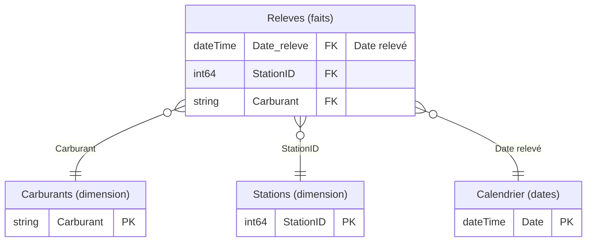

# Dictionnaire de données : Carburants

Généré par pbip-generator : 4 tables, 11 mesures, 3 relations.

## Tables

| Table | Rôle | Source | Lignes | Colonnes | Mesures |
|---|---|---|---:|---:|---:|
| Releves | faits | `releves.csv` | 70 771 | 4 | 11 |
| Carburants | dimension | `carburants.csv` | 6 | 3 | 0 |
| Stations | dimension | `stations.csv` | 884 | 8 | 0 |
| Calendrier | dates | table générée (Power Query) |  | 8 | 0 |

## Schéma du modèle



## Grain des tables de faits

- **Releves** : une ligne par `Date relevé` + `Carburant` + `StationID`

### Releves

| Colonne | Type | Format | Masquée |
|---|---|---|---|
| Date relevé | dateTime | `dd/mm/yyyy` | oui |
| StationID | int64 |  | oui |
| Carburant | string |  | oui |
| Prix au litre | double | `#,##0.00 €` | non |

### Carburants

| Colonne | Type | Format | Masquée |
|---|---|---|---|
| Carburant | string |  | non |
| Libellé carburant | string |  | non |
| Famille | string |  | non |

### Stations

| Colonne | Type | Format | Masquée |
|---|---|---|---|
| StationID | int64 |  | oui |
| Adresse | string |  | non |
| Code postal | string |  | non |
| Commune | string |  | non |
| Département | string |  | non |
| Région | string |  | non |
| Latitude | double | `#,##0.00` | oui |
| Longitude | double | `#,##0.00` | oui |

### Calendrier

| Colonne | Type | Format | Masquée |
|---|---|---|---|
| Date | dateTime | `dd/mm/yyyy` | non |
| Année | int64 | `0` | non |
| Trimestre | string |  | non |
| Mois numéro | int64 | `0` | oui |
| Mois | string |  | non |
| Année-Mois | string |  | non |
| Jour semaine numéro | int64 | `0` | oui |
| Jour semaine | string |  | non |

## Relations

| De (plusieurs) | Vers (un) | Active |
|---|---|---|
| Releves[Carburant] | Carburants[Carburant] | oui |
| Releves[StationID] | Stations[StationID] | oui |
| Releves[Date relevé] | Calendrier[Date] | oui |

## Mesures

| Mesure | Table | Dossier | Format | Description |
|---|---|---|---|---|
| Prix moyen | Releves | KPI | `#,##0.000 €` | Moyenne des prix affichés par les stations, sans pondération par les volumes vendus |
| Relevés | Releves | KPI | `#,##0` | Nombre de prix relevés (une station, un carburant, une date) |
| Stations relevées | Releves | KPI | `#,##0` | Stations qui ont au moins un prix à jour sur la période |
| Prix moyen de la région | Releves | KPI | `#,##0.000 €` | Prix moyen de toutes les stations, pour le même carburant et la même période |
| Écart à la région | Releves | KPI | `+#,##0.000 €;-#,##0.000 €;0.000 €` | Différence par litre avec la moyenne de la région ; positif = plus cher |
| Surcoût plein 50 L | Releves | KPI | `+#,##0.00 €;-#,##0.00 €;0.00 €` | Ce que coûte en plus (ou en moins) un plein de 50 litres par rapport à la région |
| Prix au premier relevé | Releves | KPI | `#,##0.000 €` | Prix moyen à la première date de la sélection |
| Prix au dernier relevé | Releves | KPI | `#,##0.000 €` | Prix moyen à la dernière date de la sélection |
| Variation sur la période | Releves | KPI | `+0.0 %;-0.0 %;0.0 %` | Évolution du prix entre le premier et le dernier relevé de la sélection |
| Écart entre stations | Releves | KPI | `#,##0.000 €` | Écart par litre entre la station la plus chère et la moins chère de la sélection, parmi les stations qui ont au moins 5 relevés |
| Couleur Écart à la région (masquée) | Releves | Couleurs |  | Couleur de mise en évidence de Écart à la région |

### Prix moyen

Expression DAX (Releves):

```dax
AVERAGE(Releves[Prix au litre])
```

### Relevés

Expression DAX (Releves):

```dax
COUNTROWS(Releves)
```

### Stations relevées

Expression DAX (Releves):

```dax
DISTINCTCOUNT(Releves[StationID])
```

### Prix moyen de la région

Expression DAX (Releves):

```dax
CALCULATE([Prix moyen], REMOVEFILTERS(Stations))
```

### Écart à la région

Expression DAX (Releves):

```dax
[Prix moyen] - [Prix moyen de la région]
```

### Surcoût plein 50 L

Expression DAX (Releves):

```dax
[Écart à la région] * 50
```

### Prix au premier relevé

Expression DAX (Releves):

```dax
VAR _d = MIN(Releves[Date relevé])
RETURN CALCULATE([Prix moyen], Calendrier[Date] = _d)
```

### Prix au dernier relevé

Expression DAX (Releves):

```dax
VAR _d = MAX(Releves[Date relevé])
RETURN CALCULATE([Prix moyen], Calendrier[Date] = _d)
```

### Variation sur la période

Expression DAX (Releves):

```dax
DIVIDE([Prix au dernier relevé] - [Prix au premier relevé], [Prix au premier relevé])
```

### Écart entre stations

Expression DAX (Releves):

```dax
VAR _prix =
    FILTER(
        ADDCOLUMNS(VALUES(Releves[StationID]), "@p", [Prix moyen], "@n", [Relevés]),
        [@n] >= 5
    )
RETURN MAXX(_prix, [@p]) - MINX(_prix, [@p])
```

### Couleur Écart à la région

Expression DAX (Releves):

```dax
VAR _v = [Écart à la région]
RETURN SWITCH(
    TRUE(),
    ISBLANK(_v), BLANK(),
    _v < -0.05, "#12B886",
    _v < 0.05, "#F59F00",
    "#E03131"
)
```
